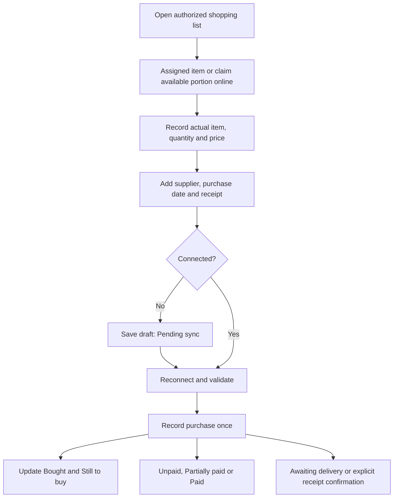

# DAC’S WorkMate — Mobile Purchasing

Date: 30 September 2026

Status: Agreed decisions consolidated for written review. Documentation only; no application or database changes implemented.

Updated: 12 October 2026. Buyer-phone and office-side decisions are consolidated. The user subsequently confirmed matching-month funding with Cover overflow, deposits/multiple supplier payments, overpayment review, main-owner-confirmed warehouse-to-project cost assignment and Project Control project-to-project material cost transfers in Stage 2. Q28 confirms separate 2B stock and 2C cost-move implementation/pilot plans, with both launching together. All 28 questions in [Stage 2 questions](2026-10-12-workmate-stage2-questions.md) were answered on 12 October 2026; **Section 3 (money rules)** and **Other decisions** below record the rest. The complete spec now awaits the user's review — this is not yet approval of implementation.

## Purpose and scope

Provide a mobile Purchasing workspace inside DAC’S WorkMate for authorized procurement staff, admin and owner. The user reports that staff handles roughly 95% of purchases and admin/owner the remaining 5%. Buyers need a usable phone workflow at suppliers and sites instead of relying on the desktop Web layout.

Use the same Flutter/Dart app and shared backend as the [WorkMate MVP](2026-09-29-unified-worker-app-design.md). Dacs Web remains available. This is not a second purchasing database or a separate app. Workers/team leaders retain their restricted views and cannot retrieve procurement amounts or receipt documents.

Project purchases remain Project Control only, with Main Contract or the relevant Additional Works selection. Warehouse purchases are also supported. This feature does not introduce PM purchasing or broaden financial authority for PM-limited owner accounts.

## Buyer assignment

**Buyer access:** use a per-person Buyer capability for staff purchasing access, alongside purchasing access for authorized admin/owner accounts within their allowed scope. Purchasing and Profile are available to staff-only buyers; buyer permission alone grants no Attendance access. Someone who independently qualifies as a worker retains their permitted Attendance features. Enforce the capability on the server as well as in navigation. Define who administers the capability in the implementation plan.

- Admin/staff can assign items or quantity portions to authorized buyers.
- Authorized buyers can tap **I’ll buy this** to claim an unassigned portion.
- Show who is handling each portion to other authorized buyers.
- Claiming, releasing and reassigning shared assignments require internet and server validation.
- Taking over another buyer's portion is an explicit, recorded reassignment.
- Prevent simultaneous claims for the same portion. Claiming is not a purchase, inventory reservation or stock movement.

**Assigned to buyer** and **Arranged with supplier** are separate facts. Tapping I’ll buy this records buyer responsibility only. A supplier arrangement records the actual order/commitment and its history. Do not automatically mark a claim Arranged. Quantity reductions use the existing rule: reduce newest unarranged demand first, then flag supplier-arranged/purchased portions for action. Releasing buyer responsibility does not cancel a supplier order or erase its purchase history.

The shopping list should highlight urgent items and quantity changes and support practical views by purchasing batch and project. Supplier grouping is useful where a supplier is known; do not require one before an item can be requested.

Default to the current weekly batch, highlight urgent items with needed-by dates, and offer a project filter. Show project/work selection, specification/unit and buyer name (Unassigned, You or named buyer). Display stock coverage when present: **Needed 10 · From stock 4 · Bought 2 · Still to buy 4**. From stock means usable quantity allocated to this demand, not a general balance available to everyone. Show fulfillment separately so allocated stock is not mistaken for goods already handed over.

## Purchasing flow

Purchase, payment and physical receipt are separate events. A recorded purchase does not prove payment or availability in inventory.

## Partial buying and clear wording

Use **Still to buy**, not **Outstanding**, on purchasing quantity displays. The Tagalog equivalent is **Kulang pang bilhin**.

Example:

| Label | Quantity |
|---|---|
| Needed | 10 pcs |
| Bought | 6 pcs |
| Still to buy | 4 pcs |

The buyer keeps the remaining 4 assigned unless they explicitly release them for another buyer. Do not automatically release a partially purchased assignment.

**Releasing never rewrites Needed.** If nothing was bought yet, releasing hands the whole assignment back unassigned. If part was bought, the rest becomes a separate claimable portion of the same request line; the original line still shows Needed 10, Bought 6, Released 4.

**Confirmed (30 September 2026): buying more than Still to buy is allowed with a required reason** (for example pack size, spare for breakage, cheaper in bulk). Record the actual purchase quantity; the extra is flagged for admin/staff and becomes usable stock only after confirmed receipt. It does not silently fulfill another request.

Require a destination for excess goods. Preserve actual purchased quantities and costs; receipt/location confirmation governs when surplus becomes usable stock. Do not silently move the cost to another project or count excess as fulfillment beyond the agreed request need.

This example assumes all 10 require purchasing. When existing stock covers part of a request, calculate the purchasing shortage first. Do not show stock-covered quantities as still needing purchase. Preserve unit/specification and quantity-portion links, arranged quantities and changes from the original request rules.

## One receipt across projects

A single receipt/purchase may contain several item lines for different projects. Enter and attach the receipt once; link each line to its request and correct PC project/work selection or warehouse destination. Preserve project allocations without duplicating the purchase, payment or expense total.

**Confirmed shared-charge rule, 12 October 2026:** a delivery fee or receipt discount covering several projects is never charged to one project automatically. By default it is split in proportion to each line's item amount (for example, a ₱200 fee over ₱3,000 of A and ₱1,000 of B gives A ₱150 and B ₱50); the buyer or office may adjust the split. Saving is refused unless the split equals the charge **and** lines + charges − discounts equal the receipt total. A rounding centavo goes to the largest share. Do not confuse the billing-period identifier with the project identifier.

## Office side (Dacs Web)

Agreed 12 October 2026.

- **Buyers:** the owner manages the staff Buyer switch. Admin/owner accounts may buy only within their own account and module scope; PM-only accounts are excluded.
- **Purchasing tab** (inside Requests): assign/reassign portions (recorded with who and when), **Mark arranged** (separate from who is buying), Still to buy, urgent items and quantity changes. **Extra quantities need no office pre-approval** — the buyer's reason and destination suffice; the office sees extras but does not block them. The office settles substitutes only in unclear cases the requester or team leader could not decide.
- **Offline conflicts:** recording a conflicted draft still runs every check (permissions, shared-charge split, duplicates). If goods were really bought, the purchase is kept as an exception to resolve; discarding removes only a draft that was never a real purchase.
- **Corrections:** one correction updates the purchase, its expense rows, the request's Bought quantities and (from 2B) stock records together — all succeed or none do. Staff may directly correct quantity, amount, supplier, date and charge split within the same project on open projects. Changing a line's project/work, or correcting a purchase on a **completed** project (`folders.completed_at` set, migration 0064), is submitted by staff and approved by the main owner. Confirmed 12 October 2026: completed is the only lock; no billed/closed billing-period marker is added.
- **Voids:** a void removes the purchase from Spent and Bought but does not claim goods were returned or money refunded. Receipt, payment and history stay; returns (2B) and refunds (payment entry) are recorded separately.
- **Paid purchases corrected later:** recorded payments are never changed silently. After a correction the purchase shows its new **remaining balance**, or **Overpaid ₱…** if payments now exceed the corrected total, for the office to resolve (see Supplier payments and Overpayment refunds below).
- **Expenses list:** expense rows created by a purchase show "From purchase …" and change only through their purchase. Web recording (admin/owner, or staff without the phone) and Expenses → Materials saves use the same server recording operation as the phone.
- **Staff access** (the rule CLAUDE.md will be updated to): purchase prices, totals, payment details and receipts — allowed within their purchasing scope; existing payroll encoding — unchanged; project profit, reimbursements, warranty fund, quotations — restricted; approving cost transfers between projects — main owner only. Workers and team leaders never see prices, receipts or payment details.

## Section 3 — Money rules on the server

Agreed 12 October 2026 (Q1–Q8, Q22–Q24 of the [Stage 2 questions](2026-10-12-workmate-stage2-questions.md)). Must respect every money invariant in `CLAUDE.md`.

### 3.1 One recording operation

One authoritative server operation records a purchase for **WorkMate and Dacs Web alike**, and the Dacs Web **Expenses → Materials** form switches to it in 2A (Q5). The funding rule therefore lives in one place, never re-implemented in Dart or browser code. Retries carry an operation id so a resent purchase is accepted once (same principle as `client_submission_id`, 0089).

**Accepted behaviour change (Q5):** today the Expenses form charges whichever period is active with budget left. From 2A, an office-entered material expense charges the period of its **actual purchase month** (3.3). A backdated October receipt entered in November charges October.

### 3.2 Purchases become ordinary expense rows

A project purchase line is charged by writing ordinary **`expenses` rows** (Material bucket), each linked back to its purchase line (and a fee share to its charge). Project Control, Reports, print and CSV therefore keep reading one table and stay in agreement; no second Spent source is introduced.

- One purchase line → **one or more** expense rows (one per funding split, 3.3). The purchase shows one line; the rows are its funding splits.
- **Warehouse** lines write **no** expense rows. Their cost is company stock cost outside every project's Spent and G&A until 2C assignment.
- Purchase-made expense rows show **"From purchase …"** and change only through the purchase (Office side, above).

### 3.3 Funding — which billing period pays

For a Main Contract line, the server:

1. Takes the **actual purchase date** (not the entry or sync date; a different document date never silently replaces it) — Q3.
2. Finds that project's billing periods in the **same month/year**, excluding Cover (president) periods and periods with no budget.
3. Computes each period's remaining fund **exactly as Dacs Web does today**: period budget − (expenses + payroll already charged to it).
4. Charges the **earliest billing number** with funds first, then the next same-month period (Q22). Missing/equal billing numbers use a stable, documented tie-break.
5. Puts any **shortage in Cover** (Q2). Never consumes another month's funds automatically (Q1).
6. If **no period exists for that month**, records the full line under Cover and flags **No matching monthly period — office review needed** (Q23). The cost is never hidden or delayed.

Example: ₱8,000 bought 14 October; October period 1 has ₱3,000 left, period 2 ₱4,000 → ₱3,000 + ₱4,000 + ₱1,000 Cover. Spent ₱8,000; Cover ₱1,000 is part of it.

**Cover link:** a Cover row goes to the project's Cover (president) period when one exists; otherwise to a valid period of the same project with `coverExpense = true`. The implementation plan fixes the exact fallback; it must never invent a period or a client allocation.

**Additional Works (Q24):** charged in full to the selected AW job's own period with no monthly cap — today's rule. A cost above its contract still counts in full and is never moved to Cover just because the contract was exceeded.

### 3.4 Delivery fees and discounts (Q4)

- A shared **delivery fee** becomes its own expense row(s) per project, named **"Delivery fee (share)"**, using the agreed split; each share is funded by 3.3 like any other amount.
- A **discount** reduces the affected line amounts before funding.
- **No negative expense rows.** Lines + fees − discounts must equal the receipt total.

### 3.5 Payments never touch Spent

Payments (deposits, partial, full, petty-cash-funded, personal-funded, refunds and supplier credits) are tracked against the **purchase**, never as expense rows. Recording or correcting a payment never changes Spent, Earned or Profit. Project Control shows **Unpaid / Partially paid / Paid** as a small read-only badge on purchase-made expense rows, **owner/admin only** (Q8); staff see no badge there.

### 3.6 Corrections and voids, in money terms

- A **correction** recomputes funding for the affected line(s) and replaces their linked expense rows in the same transaction as the purchase, Bought quantities and (from 2B) stock. Previous values stay in the purchase history. Spent changes by exactly the corrected difference.
- A **void** removes the line's expense rows from Spent and its quantities from Bought, keeping receipt, payments and history (Office side, above).
- An authorized **funding correction** (e.g. after a Q23 review creates the missing period) moves the same amount between splits; it never adds the cost twice.

### 3.7 Checks the build must pass

- Cover stays a **subset** of Spent, never a fourth bucket; allocations, G&A and the billing-allocation envelopes are untouched.
- Petty cash, personal advances, refunds and supplier credits never feed Spent / Earned / Profit.
- Every site that totals Spent or Cover (the six fenced by §I of `money-math.test.js`) reads purchase-made rows identically — extend the money tests with purchase cases (split, Cover, no matching month, AW, fee share, discount, correction, void, retry).
- Staff hiding: Project Control stays amount-free for staff (`tests/project-control-staff.test.js`).

### 3.8 Note for 2C cost moves

2C reduces one project's Spent and raises another's after main-owner confirmation. It must **not** do this with negative purchase rows (3.4) or by editing the original purchase. Use a dedicated cost-move record, read identically by every Spent site, keeping the original purchase intact. Its exact shape is part of the 2C plan.

## Other decisions — 12 October 2026

| Q | Decision |
|---|---|
| **9** | An unlisted request line **can be bought**; it must be **matched to a catalogue item before it becomes stock** (2B). |
| **10** | A simple **supplier list** (name, optional branch/contact) that buyers can add to. Safe supplier names may be shown to workers (Section 1). |
| **13** | Leftover material released to an **outside job**: Stage 2 records **evidence only** — who took it, quantity, photo, date. The original project's Spent does not change; money is reconciled in Stage 4. **Deferred scope (28 Oct 2026):** not built in 2B — the company does not give or lend materials to outside jobs. Revisit only if that changes. |
| **14** | A **partial return** from an outside job reduces the quantity still out, linked to the original release; after owner confirmation it is a **new correcting record**. History is never edited. **Deferred with Q13.** |
| **15** | **No tool lending** to outside jobs in Stage 2; decide in Stage 3 (Tools). |
| **16** | WorkMate purchasing sign-in: **staff with the Buyer switch, plus admin/owner within their account scope** — Purchasing + Profile only, no Attendance unless they also qualify as a worker. Enforced on the server. |
| **17** | **Multi-project receipt photos stay office-only** (owner/admin/Buyer staff). Clients and partners never see purchase receipts; each project's own expense rows stay visible as today. |
| **18** | Two CLAUDE.md rules are drafted below for approval **before any Stage 2 code**. |
| **19** | Buyers may use WorkMate **before the worker switch-over** (0E). |
| **20** | Pilot buyer and project: **decided when 2A is ready to test**. |
| **21** | Build order: **My Work (1c) → 2A → 2B + 2C (joint launch)**. Migration numbers are taken at build time (highest on disk + 1). |
| **Petty cash** | Unused petty cash is returned **at the end of the buying run** (not necessarily the same day); until then the tracker shows it as held. |

### Proposed CLAUDE.md rules (Q18 — for approval, not yet applied)

Add under *Money invariants*:

> - **Purchasing (WorkMate Stage 2) — staff exception.** Staff with the **Buyer** switch may see purchase prices, totals, supplier payments and receipts **within their buying scope**, in Purchasing screens only. Project profit, reimbursements, warranty fund and quotations stay restricted, and Project Control stays amount-free for staff. Approving cost moves between projects or from warehouse stock is **main owner only**. Workers and team leaders never see prices, receipts or payments.
> - **Petty cash, personal advances, supplier refunds and supplier credits are outside the money model.** They track who holds or is owed company money. Nothing may feed them into Spent / Earned / Profit, and issuing, returning or repaying money never creates an expense. Only a recorded **purchase** adds to Spent, once, through the shared recording operation.

## Substitutes and unplanned purchases

**Confirmed replacement rule, 12 October 2026:** model, code and brand are optional unless an exact match is required. Buyers may choose an equivalent that meets the confirmed requirements. If an important specification changes, obtain confirmation before buying from the requester or their explicitly assigned team leader; admin/staff resolves unclear cases. Retain the proposed replacement photo/specifications, confirmation and reason. Ordinary matching purchases need no new approval gate. This supersedes notification-only handling for specification-changing substitutes.

Keep the original request visible, record the actual replacement specification/unit and notify the requester. Different units are not automatically converted. Catalogue matching remains required before stock tracking; a replacement must not silently become stock of the original item. Do not block honest recording of an already-made purchase that failed this process: retain it as an exception for office resolution, without inventing prior confirmation.

Authorized buyers may record an **Unplanned purchase** without a prior request. Require a reason and valid Project Control project/work selection or warehouse destination. Keep it separate from requested quantities; it cannot silently fulfill an unrelated request. **Confirmed:** a warehouse destination is company stock cost, not any project's Spent, until the main owner assigns the issued portion to a project (see the MVP scope §4F warehouse rule).

## Supplier payments

**Petty cash — confirmed 12 October:** the owner gives actual company money to the buyer for material purchases, called **petty cash**. The buyer returns unused money to the owner; automatic carry-forward is not the agreed workflow. The owner requires a **day-by-day report**. **Return deadline — approved 12 October: unused cash is returned at the end of the buying run.** Evidence/corrections, offline reporting and other reconciliation permissions still need clarification; owner receipt confirmation is approved below.

Petty cash is company money held by the buyer, not their personal advance or a project billing allocation. Issuing/returning it does not create a material expense or change Spent. It also does not automatically label purchases Cover; the agreed period/Cover cost-funding rules remain separate. Cash held follows actual petty-cash receipts, supplier payments from that cash and returns. Unpaid purchase cost affects project Spent but does not reduce cash held until actually paid.

**Petty-cash return confirmation — approved 12 October:** when the buyer records a cash return, show **Return awaiting confirmation**. The buyer cannot clear their recorded balance merely by reporting a return. Only the owner confirms that the money was actually received; only then does that returned amount reduce the buyer's recorded balance. Keep pending-return amounts visibly separate so they are not mistaken for confirmed returns. Retain reported handover and owner-confirmation details/history. Issuing, reporting or confirming a return does not change project Spent or create another supplier payment.

**Owner petty-cash tracker + daily report — approved 12 October:** use one set of accepted petty-cash issues, linked supplier payments and returns to show each buyer's money received, actual payments, returned money, money still held and unexplained differences. The owner can open supplier payments to see the purchased items, project, actual payment date and receipts. Respect the owner's company/account scope. Generate the Philippine-day report from those same records without duplicate encoding/payment entries.

For each day: **opening cash held + petty cash received that day + actual supplier refunds received back into that petty cash that day − supplier payments made from that petty cash that day − owner-confirmed cash returns attributed to that day = recorded closing balance**. Keep purchase Spent, unpaid supplier balances and personal-funded payments separate; do not debit petty cash merely because a purchase was recorded. Example: ₱10,000 received − ₱6,500 supplier payments − ₱0 returned = ₱3,500 still held.

Reported returns show **Return awaiting confirmation** until the owner acknowledges actual receipt. They do not reduce the buyer's recorded balance while pending; show their amount separately. Keep reported handover date and confirmation date/history and define how late confirmations affect daily reports before implementation. Tracker balances reflect the latest accepted/synced entries with last-updated information. An offline buyer's unsent payment is not a confirmed owner balance; show freshness clearly rather than promising instant visibility. Keep return evidence and who received the money; submitting a report alone must not imply the owner received cash. Deposit payments appear as the actual amounts paid that day, not the full purchase value. Personal-funded payments stay separate; Q26 now approves personal-advance repayment tracking only as the owner-authorized fallback described below. Evidence/correction and late-confirmation report rules, discrepancies, exact refund/credit recipient/review/application rules, other permissions and reconciliation still need design. This feature must not reuse Client Reimbursement or create payroll/invoice/accounting side effects. This is design only.

**Confirmed 12 October 2026:** suppliers receive deposits, and a purchase may have multiple payments. This supersedes the earlier Paid/Unpaid-only scope. Show **Unpaid**, **Partially paid** or **Paid**, together with the remaining balance. Each payment is retained separately; do not overwrite a deposit with a final payment.

**Confirmed by the user: project material purchases count toward Spent when recorded, regardless of payment status.** Marking Paid updates payment tracking only; it does not add another expense or change Spent or Profit by itself. An offline draft is not a recorded purchase until accepted by the server. General warehouse purchases retain the separate unassigned-stock-cost and owner-confirmed project assignment rules.

The actual payer may be the **buyer, office staff or owner**, depending on the purchase. Record each payment's **payer, amount, actual date and method**, linked to the existing purchase, and retain who encoded it separately. Recording permissions still follow the authorized purchasing scope and need exact definition; being a possible payer is not unrestricted access. Payments do not create another purchase or material expense.

For a receipt spanning projects, each actual payment is recorded once at the **purchase level**, not copied to every project or expense split; lines retain their project allocations. Payment does not confirm delivery.

**Overpayment — confirmed 12 October:** preserve the actual payment even if cumulative payments exceed the purchase total, flag the excess as **Overpaid** and send it for office review. Do not automatically increase purchase cost or Spent. Example: ₱10,500 paid against ₱10,000 purchase shows ₱500 Overpaid. Actual refunds and confirmed supplier credits are approved in Q27 below; exact review/recipient/application, correction and post-void payment rules remain to define.

## Owner-authorized personal advances

**Personal-money fallback — approved 12 October (Q26):** the normal response to insufficient petty cash is to **ask the owner for more petty cash**. A buyer may instead use personal money for a purchase/extra amount **only when the owner allows it**. Record that authorization and the actual personal-funded payment separately from company-funded payments. Track the amount **Company owes buyer**, with supporting purchase/payment evidence, repayments and remaining balance. A repayment settles that advance; it is not a new material expense, supplier payment or petty-cash issue. Do not infer personal funding merely from who handed money to the supplier. Exact authorization/evidence, verification, repayment permissions and partial repayment/correction rules still need design.

Keep this balance separate from Client Reimbursement, which tracks recovery from clients. A buyer-funded supplier payment reduces the supplier balance but does not reduce company petty cash held; only the company-funded portion does. Company repayment of the advance must not be counted again as a supplier payment, material expense or company money still held by the buyer. Preserve actual purchases/payments and flag an unsupported authorization claim for office review rather than inventing prior permission or silently discarding evidence.

## Overpayment refunds and supplier credit

**Overpayment resolution — approved 12 October (Q27):** support both an actual **refund** and confirmed **supplier credit**, linked to the original overpayment with separate evidence/history. A note alone cannot clear money still recoverable. Preserve original payment and purchase records; resolving an overpayment does not automatically change purchase cost or project Spent. A genuine purchase-cost correction remains a separate audited operation.

A cash refund reduces the unresolved recoverable amount; confirmed supplier credit remains a separate visible balance until applied or otherwise resolved. Example: ₱500 overpaid → ₱200 cash refund + ₱300 confirmed supplier credit, without rewriting the original payment. Prevent resolving the same excess twice. Record who actually received a refund and whether the original payment used company petty cash, personal funds or mixed funds. Only a refund actually received into the company petty-cash fund increases that fund's cash balance; supplier credit is not cash, and a refund to a person for their own money must not be counted as company petty cash. Personal-advance repayment/refund allocation still needs an exact owner-reviewed rule.

Credit applied to a later purchase is a settlement source, not a fake cash payment or a discount that erases the new purchase cost. For example, a new ₱1,000 purchase settled with ₱500 existing credit and ₱500 cash remains ₱1,000 purchase cost; only ₱500 leaves petty cash, and that credit is consumed once. Define authorization, supplier/company scope, proof, recipient/source allocation, partial refund/credit application, corrections and retries before implementation.

## Warehouse cost assignment — Stage 2C, joint launch with 2B stock

**Approved 12 October 2026:** bring main-owner-confirmed assignment of **company-purchased warehouse stock** to a Project Control project forward into **Stage 2**. Q28 places physical stock operations in **2B** and cost assignment in **2C**, with both launching together. Staff records the physical issue; show **Cost assignment pending** until the main owner confirms the issued portion's cost. Confirmation adds that cost to the receiving project's **Material** bucket and **Spent**, while unused stock cost remains with company stock. It creates no second purchase or supplier payment, and cost can be assigned only once for each issued portion.

Example: 20 bags bought for warehouse stock cost ₱10,000. After 8 bags are issued to Project A and the main owner confirms, Project A carries ₱4,000 Material/Spent and the remaining 12 bags carry ₱6,000 unassigned warehouse stock cost.

Warehouse assignment does not turn project-owned leftovers stored in the warehouse into unassigned company stock. Their cost stays with the source project until a main-owner-confirmed PC-to-PC transfer, as approved below. Outside-job releases are evidence-only in Stage 2 (Q13); their money is reconciled in Stage 4. Preserve original source/cost history. Before the joint 2B/2C launch, define issued-cost valuation, the receiving billing period/Cover treatment, partial issues/returns, retries and reports. No code or database change is authorized by this design decision alone.

## Project-to-project material cost transfers — Stage 2C, joint launch with 2B stock

**Approved 12 October 2026:** bring **main-owner-confirmed transfers of leftover material cost between Project Control projects** forward into **Stage 2**. Q28 places physical movement in **2B** and cost transfer in **2C**, with both launching together. Staff records the physical move. Until the main owner confirms, the original cost stays with the source project and shows **Cost transfer pending**. Confirmation reduces the source project's Material/Spent and increases the receiving project's Material/Spent by the same original purchase cost for that portion. Both sides succeed together, and retries cannot transfer the same portion twice.

Example: Project A bought 10 outlets for ₱1,000. Project B receives 2 unused outlets. After main-owner confirmation of ₱200, A carries ₱800 and B ₱200; total purchase spending stays ₱1,000. Preserve the original purchase, payment, receipt and source history; there is no new purchase or supplier payment. Moving A's leftovers into warehouse storage alone still leaves their cost with A.

**Period selection — approved (Q25):** the source reduction belongs to the linked expense/funding rows and periods that originally carried the transferred material cost. The destination cost belongs to the month/year the receiving project actually received that portion; retain receiving, shipping and owner-confirmation dates separately. Example: A's September purchase supplies ₱200 of materials received by B in October → owner-approved correction reduces A's original September cost and charges B's October cost by ₱200, together and once. Do not rewrite the original purchase/payment date or select an unrelated source period.

This approval is **PC-to-PC only**, not an automatic transfer and not authorization for outside-job/PM cost integration. Before the joint 2B/2C launch, define exact original split-row reversals, source/destination client/Cover attribution, eligible-period ordering and missing-period handling, verified valuation and transferable quantities, partial transfers/returns, pending/rejected decisions, retries and report effects. Q25 settles the source reference and receiving month, not every funding detail. Main-owner confirmation remains required. Stage 4 retains external cost handling and broader reconciliation/reporting.

## Direct-to-site receiving

An authorized admin/staff buyer may confirm receipt in the same purchasing flow, while online. Require an explicit confirmation of actual received quantity, location and condition. Do not infer receipt from saving a purchase or uploading a receipt image.

Only actual confirmed usable quantities become available under existing inventory rules. Partial receipt leaves the rest awaiting delivery. Preserve separate purchase and receipt event identities so retries do not add stock twice. This approval does not expand worker/team-leader material receiving authority or resolve any additional owner receiving permission beyond existing rules.

## Offline drafts and changes

### Corrections and later payments

Drafts remain editable. After server acceptance, buyers do not directly overwrite purchase lines or amounts. They can submit a correction note with supporting evidence for an authorized office reviewer. Corrections preserve the original record and history and reconcile affected expense, request and stock records without duplicate spending/movements. Exact office correction permissions and reversal handling belong in the implementation plan.

This purchase protection does not block an authorized later **Record payment** action or separate receipt confirmation. Deposits and further payments stay linked to the same purchase with traceable corrections, as confirmed above. Payment sync and retry rules must prevent duplicated deposits, balances and overpayment alerts.

Nonfinancial supplier names and safe product-source references may be visible to workers where useful for item identification. Purchase prices, financial receipt files and private supplier/payment details remain restricted. Do not introduce a blanket ban on every supplier name.

Buyers can save purchase details and receipt photos offline as drafts. Display **Pending sync**; do not update shared Bought totals, payment records or stock until validated server acceptance. Previously downloaded lists must show that they may be stale.

Reconnection rechecks assignment, permissions, current request changes and operation identity. If another buyer or staff changed the assigned portion, retain the draft and evidence for resolution. Do not silently discard a real purchase or count it twice. Offline drafts cannot guarantee that no other person has bought the goods; assignment and visible synchronization state reduce this risk.

Preserve drafts/photos across restart, isolate them by account and retain unsent attachments during cache cleanup. Final stock receipt, claims and reassignment remain online. Specify the exact conflict and payment-sync rules in the technical plan.

## Prototype and acceptance examples

1. Staff assigns part of a shopping list; another authorized buyer claims an unassigned portion online.
2. A buyer assigned 10 purchases 6. Show Bought 6 and Still to buy 4; retain the remaining assignment.
3. The buyer releases that 4 online so another buyer can claim it.
4. One receipt contains lines for two PC projects; each actual payment is recorded once against the purchase, with no duplicated costs or project-level payment copies.
5. Buyer records a substitute with a reason, preserving original and actual specifications.
6. Buyer records an unplanned warehouse purchase with a reason.
7. A ₱10,000 project purchase counts as ₱10,000 Spent once. Payments of ₱3,000, ₱2,000 and ₱5,000 show Partially paid until the final payment, then Paid; every payment retains payer/date/method. An additional ₱500 payment is kept and flagged Overpaid for office review, without changing Spent.
8. Buyer saves receipt details offline, then syncs safely after an assignment or quantity change.
9. Authorized staff records a direct-site purchase and explicitly confirms actual receipt online. A retry does not increase stock again.
10. Worker/team-leader screens and direct calls cannot access purchase prices or receipt files.
11. In the joint 2B stock / 2C cost-move launch, a PC-to-PC material move leaves cost with the source until main-owner confirmation; balanced cost transfer preserves the total, the original purchase/payment and source history. A retry cannot move cost twice.

## Delivery boundary

### Resolve before Stage 2 implementation

- **Implement the confirmed purchase/payment rule:** project purchases affect Spent on recording regardless of payment status. Verify that recording payment never duplicates expense or changes Spent/Profit by itself; preserve separate warehouse cost assignment. The business decision is settled, not an open question.
- **Shared recording operation:** the current Web expense save splits costs across funding periods and routes overflow to Cover. **Decided (Q5, Section 3.1):** one authoritative server-side recording operation for WorkMate, Dacs Web purchasing and Expenses → Materials, using the matching-month rule of 3.3, actual purchase quantities and safe retries. Do not duplicate that logic in Dart or bypass it from Web. Not yet built.
- **Funding — confirmed 12 October (Main Contract):** a purchase normally charges the billing period matching its actual purchase month, even if recorded later. If ₱10,000 is bought in October and October has ₱6,000 left, charge ₱6,000 to October and ₱4,000 to Cover. **Same-month order — approved (Q22):** consume the earliest billing number with remaining funds in the actual purchase month/year, then the next eligible same-month period, then Cover for any shortage. Example: ₱8,000 purchase with ₱3,000 in October period 1 and ₱4,000 in period 2 → ₱3,000 + ₱4,000 + ₱1,000 Cover. Keep one purchase line linked to its funding splits, which may number more than two; Cover remains a subset of Spent. Do not automatically consume another month's funds. **No matching period — approved (Q23):** record the actual project purchase under Cover, flag **No matching monthly period — office review needed**, and do not automatically use another month or suppress the cost while waiting. Later authorized funding corrections preserve the original purchase/date and never duplicate Spent. Define a valid Cover billing-period link, stable missing/equal-number tie-breaks and correction/reallocation permissions before implementation. Purchase date, recording time, payments and physical receiving remain separate facts.
- **Additional Works — approved (Q24):** preserve today's exception to the Main Contract monthly-funding rule: record the full purchase cost against the selected Additional Works job's own period without a monthly funding cap. A ₱20,000 agreed contract with ₱22,000 actual costs still reports ₱22,000 Spent and the overrun; do not automatically route ₱2,000 to Cover merely because the contract was exceeded. Existing explicit funding/source history, approved scope and contract remain intact, and profit retains the Earned/Forecast rules. Define valid owning-period handling before implementation; do not silently charge the parent Main Contract.
- **Buyer authorization and sign-in — decided (Q16):** Buyer staff plus admin/owner within scope; Purchasing + Profile only. The owner manages the Buyer switch (Office side). The plan still verifies dual-capability accounts and limited-owner scopes on the server.
- **Shared receipt privacy — decided (Q17):** multi-project receipt originals stay office-only. The plan defines the storage folder rule under 0081 (new top folder → `uploads_can_read`/`uploads_can_write` + `FOLDERS` in `tests/storage-access.test.js`); never a broad storage permission.
- **Instruction alignment — drafted (Q18):** the two proposed CLAUDE.md rules in *Other decisions* are applied (and any applicable AGENTS.md updated) once the user approves them, before Stage 2 coding.

Design this workspace alongside the WorkMate prototype, clearly labelling simulated purchasing and inventory actions. Verified buying and receiving depend on the Stage 2 purchasing/inventory plan. Exact release sequencing, buyer authorization, payment representation, receipt allocation and migration from existing expense paths require an inspected implementation plan before coding.

The new mobile flow must reuse authoritative purchasing records and preserve current money rules. It must not become an additional stock-add path alongside the existing expense/inventory and delivery paths.
