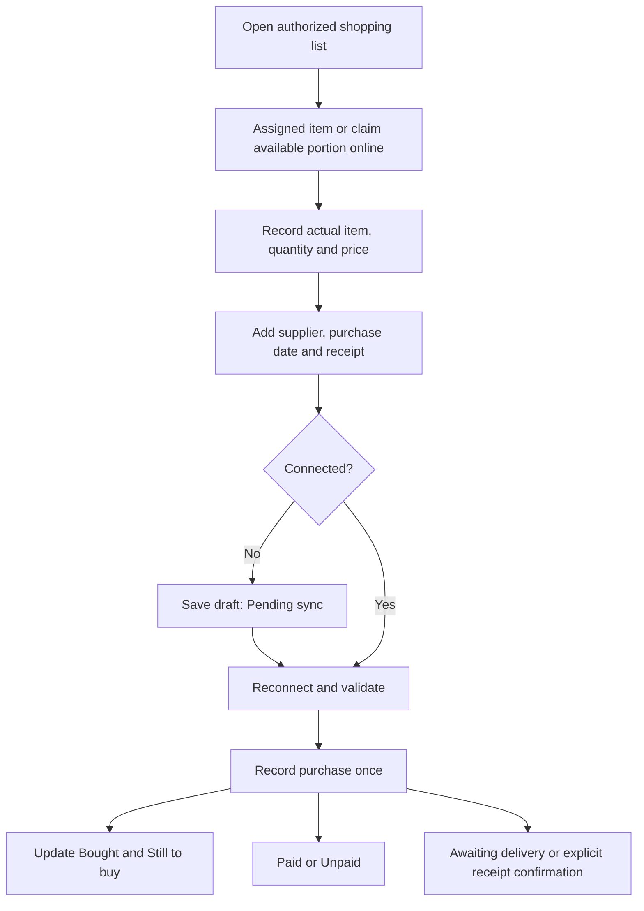

# DAC’S WorkMate — Mobile Purchasing

Date: 30 September 2026

Status: Agreed decisions consolidated for written review. Documentation only; no application or database changes implemented.

Updated: 12 October 2026. The user accepted the review recommendations for the buyer-phone design; the rules below incorporate them. Unresolved receipt-allocation and billing-period details remain explicit planning decisions.

## Purpose and scope

Provide a mobile Purchasing workspace inside DAC’S WorkMate for authorized procurement staff, admin and owner. The user reports that staff handles roughly 95% of purchases and admin/owner the remaining 5%. Buyers need a usable phone workflow at suppliers and sites instead of relying on the desktop Web layout.

Use the same Flutter/Dart app and shared backend as the [WorkMate MVP](2026-09-29-unified-worker-app-design.md). Dacs Web remains available. This is not a second purchasing database or a separate app. Workers/team leaders retain their restricted views and cannot retrieve procurement amounts or receipt documents.

Project purchases remain Project Control only, with Main Contract or the relevant Additional Works selection. Warehouse purchases are also supported. This feature does not introduce PM purchasing or broaden financial authority for PM-limited owner accounts.

## Buyer assignment

**Buyer access:** use a per-person Buyer capability for staff purchasing access, alongside purchasing access for authorized admin/owner accounts within their allowed scope. Purchasing and Profile are available to staff-only buyers; buyer permission alone grants no Attendance access. Someone who independently qualifies as a worker retains their permitted Attendance features. Enforce the capability on the server as well as in navigation. Define who administers the capability in the implementation plan.

- Admin/staff can assign items or quantity portions to authorized buyers.
- Authorized buyers can tap **I’ll buy this** to claim an unassigned portion.
- Show who is handling each portion to other authorized buyers.
- Claiming, releasing and reassigning shared assignments require internet and server validation.
- Taking over another buyer's portion is an explicit, recorded reassignment.
- Prevent simultaneous claims for the same portion. Claiming is not a purchase, inventory reservation or stock movement.

**Assigned to buyer** and **Arranged with supplier** are separate facts. Tapping I’ll buy this records buyer responsibility only. A supplier arrangement records the actual order/commitment and its history. Do not automatically mark a claim Arranged. Quantity reductions use the existing rule: reduce newest unarranged demand first, then flag supplier-arranged/purchased portions for action. Releasing buyer responsibility does not cancel a supplier order or erase its purchase history.

The shopping list should highlight urgent items and quantity changes and support practical views by purchasing batch and project. Supplier grouping is useful where a supplier is known; do not require one before an item can be requested.

Default to the current weekly batch, highlight urgent items with needed-by dates, and offer a project filter. Show project/work selection, specification/unit and buyer name (Unassigned, You or named buyer). Display stock coverage when present: **Needed 10 · From stock 4 · Bought 2 · Still to buy 4**. From stock means usable quantity allocated to this demand, not a general balance available to everyone. Show fulfillment separately so allocated stock is not mistaken for goods already handed over.

## Purchasing flow

Purchase, payment and physical receipt are separate events. A recorded purchase does not prove payment or availability in inventory.

## Partial buying and clear wording

Use **Still to buy**, not **Outstanding**, on purchasing quantity displays. The Tagalog equivalent is **Kulang pang bilhin**.

Example:

| Label | Quantity |
|---|---|
| Needed | 10 pcs |
| Bought | 6 pcs |
| Still to buy | 4 pcs |

The buyer keeps the remaining 4 assigned unless they explicitly release them for another buyer. Do not automatically release a partially purchased assignment.

**Releasing never rewrites Needed.** If nothing was bought yet, releasing hands the whole assignment back unassigned. If part was bought, the rest becomes a separate claimable portion of the same request line; the original line still shows Needed 10, Bought 6, Released 4.

**Confirmed (30 September 2026): buying more than Still to buy is allowed with a required reason** (for example pack size, spare for breakage, cheaper in bulk). Record the actual purchase quantity; the extra is flagged for admin/staff and becomes usable stock only after confirmed receipt. It does not silently fulfill another request.

Require a destination for excess goods. Preserve actual purchased quantities and costs; receipt/location confirmation governs when surplus becomes usable stock. Do not silently move the cost to another project or count excess as fulfillment beyond the agreed request need.

This example assumes all 10 require purchasing. When existing stock covers part of a request, calculate the purchasing shortage first. Do not show stock-covered quantities as still needing purchase. Preserve unit/specification and quantity-portion links, arranged quantities and changes from the original request rules.

## One receipt across projects

A single receipt/purchase may contain several item lines for different projects. Enter and attach the receipt once; link each line to its request and correct PC project/work selection or warehouse destination. Preserve project allocations without duplicating the purchase, payment or expense total.

**Confirmed shared-charge rule, 12 October 2026:** a delivery fee or receipt discount covering several projects is never charged to one project automatically. By default it is split in proportion to each line's item amount (for example, a ₱200 fee over ₱3,000 of A and ₱1,000 of B gives A ₱150 and B ₱50); the buyer or office may adjust the split. Saving is refused unless the split equals the charge **and** lines + charges − discounts equal the receipt total. A rounding centavo goes to the largest share. Do not confuse the billing-period identifier with the project identifier.

## Office side (Dacs Web)

Agreed 12 October 2026.

- **Buyers:** the owner manages the staff Buyer switch. Admin/owner accounts may buy only within their own account and module scope; PM-only accounts are excluded.
- **Purchasing tab** (inside Requests): assign/reassign portions (recorded with who and when), **Mark arranged** (separate from who is buying), Still to buy, urgent items and quantity changes. **Extra quantities need no office pre-approval** — the buyer's reason and destination suffice; the office sees extras but does not block them. The office settles substitutes only in unclear cases the requester or team leader could not decide.
- **Offline conflicts:** recording a conflicted draft still runs every check (permissions, shared-charge split, duplicates). If goods were really bought, the purchase is kept as an exception to resolve; discarding removes only a draft that was never a real purchase.
- **Corrections:** one correction updates the purchase, its expense rows, the request's Bought quantities and (from 2B) stock records together — all succeed or none do. Staff may directly correct quantity, amount, supplier, date and charge split within the same project on open projects. Changing a line's project/work, or correcting a purchase on a **completed** project (`folders.completed_at` set, migration 0064), is submitted by staff and approved by the main owner. Confirmed 12 October 2026: completed is the only lock; no billed/closed billing-period marker is added.
- **Voids:** a void removes the purchase from Spent and Bought but does not claim goods were returned or money refunded. Receipt, payment and history stay; returns (2B) and refunds (payment entry) are recorded separately.
- **Paid purchases corrected later:** the actual payment is never changed silently. If the corrected total differs from what was paid, show **"Payment differs by ₱…"** for the office to resolve.
- **Expenses list:** expense rows created by a purchase show "From purchase …" and change only through their purchase. Web recording (admin/owner, or staff without the phone) and Expenses → Materials saves use the same server recording operation as the phone.
- **Staff access** (the rule CLAUDE.md will be updated to): purchase prices, totals, payment details and receipts — allowed within their purchasing scope; existing payroll encoding — unchanged; project profit, reimbursements, warranty fund, quotations — restricted; approving cost transfers between projects — main owner only. Workers and team leaders never see prices, receipts or payment details.

## Substitutes and unplanned purchases

**Confirmed replacement rule, 12 October 2026:** model, code and brand are optional unless an exact match is required. Buyers may choose an equivalent that meets the confirmed requirements. If an important specification changes, obtain confirmation before buying from the requester or their explicitly assigned team leader; admin/staff resolves unclear cases. Retain the proposed replacement photo/specifications, confirmation and reason. Ordinary matching purchases need no new approval gate. This supersedes notification-only handling for specification-changing substitutes.

Keep the original request visible, record the actual replacement specification/unit and notify the requester. Different units are not automatically converted. Catalogue matching remains required before stock tracking; a replacement must not silently become stock of the original item. Do not block honest recording of an already-made purchase that failed this process: retain it as an exception for office resolution, without inventing prior confirmation.

Authorized buyers may record an **Unplanned purchase** without a prior request. Require a reason and valid Project Control project/work selection or warehouse destination. Keep it separate from requested quantities; it cannot silently fulfill an unrelated request. **Confirmed:** a warehouse destination is company stock cost, not any project's Spent, until the main owner assigns the issued portion to a project (see the MVP scope §4F warehouse rule).

## Paid or Unpaid

The MVP has **Paid** and **Unpaid** only. Partial-payment tracking is excluded.

**Confirmed by the user: project material purchases count toward Spent when recorded, whether Paid or Unpaid.** Marking Paid updates payment tracking only; it does not add another expense or change Spent or Profit by itself. An offline draft is not a recorded purchase until accepted by the server. General warehouse purchases retain the separate unassigned-stock-cost and owner-confirmed project assignment rules.

When marking a purchase Paid, record its payment **amount, actual date and method**, linked to the existing purchase. These payment details do not create another purchase or material expense. For an Unpaid purchase, add the payment details when it is paid.

For a receipt spanning projects, record the payment once at the purchase level; item lines retain their project allocations. Payment does not confirm delivery. Define amount validation, corrections and treatment of mismatches before implementation; do not silently classify a partial amount as full settlement or add a Partially paid workflow.

## Direct-to-site receiving

An authorized admin/staff buyer may confirm receipt in the same purchasing flow, while online. Require an explicit confirmation of actual received quantity, location and condition. Do not infer receipt from saving a purchase or uploading a receipt image.

Only actual confirmed usable quantities become available under existing inventory rules. Partial receipt leaves the rest awaiting delivery. Preserve separate purchase and receipt event identities so retries do not add stock twice. This approval does not expand worker/team-leader material receiving authority or resolve any additional owner receiving permission beyond existing rules.

## Offline drafts and changes

### Corrections and later payments

Drafts remain editable. After server acceptance, buyers do not directly overwrite purchase lines or amounts. They can submit a correction note with supporting evidence for an authorized office reviewer. Corrections preserve the original record and history and reconcile affected expense, request and stock records without duplicate spending/movements. Exact office correction permissions and reversal handling belong in the implementation plan.

This purchase protection does not block an authorized later **Mark Paid** action on an Unpaid purchase, nor separate receipt confirmation. Record the payment amount/date/method against the same purchase with traceable corrections. No partial-payment workflow is added.

Nonfinancial supplier names and safe product-source references may be visible to workers where useful for item identification. Purchase prices, financial receipt files and private supplier/payment details remain restricted. Do not introduce a blanket ban on every supplier name.

Buyers can save purchase details and receipt photos offline as drafts. Display **Pending sync**; do not update shared Bought totals, payment records or stock until validated server acceptance. Previously downloaded lists must show that they may be stale.

Reconnection rechecks assignment, permissions, current request changes and operation identity. If another buyer or staff changed the assigned portion, retain the draft and evidence for resolution. Do not silently discard a real purchase or count it twice. Offline drafts cannot guarantee that no other person has bought the goods; assignment and visible synchronization state reduce this risk.

Preserve drafts/photos across restart, isolate them by account and retain unsent attachments during cache cleanup. Final stock receipt, claims and reassignment remain online. Specify the exact conflict and payment-sync rules in the technical plan.

## Prototype and acceptance examples

1. Staff assigns part of a shopping list; another authorized buyer claims an unassigned portion online.
2. A buyer assigned 10 purchases 6. Show Bought 6 and Still to buy 4; retain the remaining assignment.
3. The buyer releases that 4 online so another buyer can claim it.
4. One receipt contains lines for two PC projects, with one payment and no duplicated costs.
5. Buyer records a substitute with a reason, preserving original and actual specifications.
6. Buyer records an unplanned warehouse purchase with a reason.
7. Purchase is Unpaid, later marked Paid with amount/date/method, without a second expense.
8. Buyer saves receipt details offline, then syncs safely after an assignment or quantity change.
9. Authorized staff records a direct-site purchase and explicitly confirms actual receipt online. A retry does not increase stock again.
10. Worker/team-leader screens and direct calls cannot access purchase prices or receipt files.

## Delivery boundary

### Resolve before Stage 2 implementation

- **Implement the confirmed purchase/payment rule:** project purchases affect Spent on recording regardless of payment status. Verify that recording payment never duplicates expense or changes Spent/Profit by itself; preserve separate warehouse cost assignment. The business decision is settled, not an open question.
- **Shared recording operation:** the current Web expense save splits costs across funding periods and routes overflow to Cover. Recommend one authoritative server-side purchase-recording operation for Web and Flutter, preserving verified allocation/Cover behavior, actual purchase quantities and safe retries. Do not duplicate that logic in Dart or bypass it from Web. This is a proposed implementation direction, not implemented infrastructure.
- **Billing-period selection:** decide whether the buyer selects eligible funding periods or the server proposes/assigns them, and how staff reviews exceptions. Project selection alone does not identify a billing period.
- **Buyer authorization and sign-in:** the per-person Buyer capability and role-aware navigation are approved. Specify capability administration and extend worker/team-leader sign-in deliberately for authorized staff/admin/owner modes. Verify dual-capability accounts and limited-owner scopes on the server.
- **Shared receipt privacy:** define storage and line/document access under 0081 for receipts spanning projects. Access to one project must not automatically expose another project's receipt lines or amounts. Decide whether financial originals stay staff-only and project viewers receive scoped/redacted documents; do not solve this with a broad storage permission.
- **Instruction alignment:** before Stage 2 coding, update the blanket staff-peso rule in CLAUDE.md and any applicable AGENTS.md to document the approved procurement exception and preserved legacy payroll access. Keep unrelated owner-only records restricted. This spec does not itself modify those instruction files.

Design this workspace alongside the WorkMate prototype, clearly labelling simulated purchasing and inventory actions. Verified buying and receiving depend on the Stage 2 purchasing/inventory plan. Exact release sequencing, buyer authorization, payment representation, receipt allocation and migration from existing expense paths require an inspected implementation plan before coding.

The new mobile flow must reuse authoritative purchasing records and preserve current money rules. It must not become an additional stock-add path alongside the existing expense/inventory and delivery paths.
